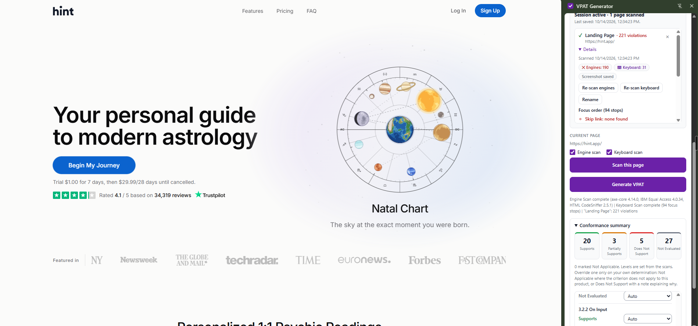
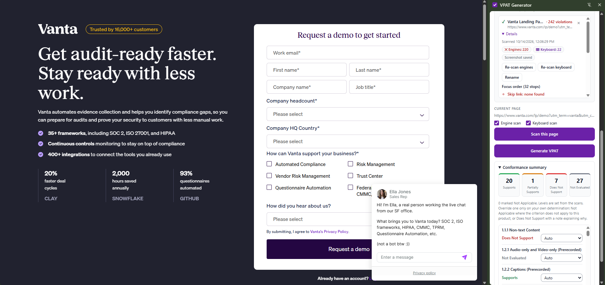

# VPAT Generator — Chrome Extension

A Chrome extension that scans web pages for WCAG 2.2 accessibility issues and auto-drafts a VPAT® 2.5 Accessibility Conformance Report (ACR) in `.docx` or `.pdf` format.

Built as a tool for accessibility practitioners and procurement reviewers who need defensible, audit-ready documentation without manually compiling results from multiple scanners.

---

## What it does

- Runs three scanning engines in parallel: **axe-core 4.14.0**, **IBM Equal Access 4.0.34**, and **HTML CodeSniffer 2.5.1**
- Simulates keyboard navigation to detect focus traps and missing skip links
- Maps violations to WCAG 2.2 Level A and AA success criteria
- Applies conformance threshold logic automatically:
  - 0 violations → **Supports**
  - 1–4 violations → **Partially Supports**
  - 5+ violations → **Does Not Support**
  - 2.4.1 (bypass blocks) → binary **Does Not Support**
- Generates a structured VPAT 2.5Rev document with per-criterion findings, violation counts, and affected URLs
- Exports to `.docx` (editable) or `.pdf`

---

## Why three engines

No single scanner catches everything. axe-core, IBM Equal Access, and HTML CodeSniffer each have different rule sets and heuristics. Running all three and deduplicating gives broader coverage and reduces false negatives — especially important when producing documentation that may be reviewed by a client's procurement or legal team.

---

## Tech

| Layer | Stack |
|---|---|
| Extension platform | Chrome Manifest V3, Side Panel API |
| Scanning | axe-core 4.14.0, IBM Equal Access 4.0.34, HTML CodeSniffer 2.5.1 |
| Keyboard simulation | Custom content script |
| Document generation | docx.js (.docx), pdfmake (.pdf) |
| State persistence | `localStorage` (session survives closing the panel and browser restarts) |

---

## Install (developer mode)

1. Clone or download this repo
2. Open Chrome → `chrome://extensions`
3. Enable **Developer mode** (top right toggle)
4. Click **Load unpacked** → select the repo folder (the one that contains `manifest.json`)
5. Click the extension icon to open the side panel

---

## Usage

1. Open the side panel on any web page
2. Enter a product name in **Report settings** (required — appears in the VPAT header)
3. Click **Scan this page** — results appear per WCAG criterion
4. Scan additional pages as needed (each adds to the report). Use **Clear Session** to start a new product.
5. Click **Generate VPAT** → choose `.docx` or `.pdf`

---

## Sample output

- [`hint-astrology-app-VPAT-2026-10-14.pdf`](./sample/hint-astrology-app-VPAT-2026-10-14.pdf) — scan of Hint Astrology App
- [`vanta-web-VPAT-2026-10-14.pdf`](./sample/vanta-web-VPAT-2026-10-14.pdf) — scan of Vanta web app

---

## Limitations

This tool drafts a VPAT. It doesn't replace an accessibility expert.

- Automated scanners only catch part of WCAG issues. Things like screen reader announcements, whether alt text actually makes sense, reading order, and complex keyboard flows still need manual testing.
- Conformance levels are based on violation counts, which is a proxy, not a judgment. Every report should be reviewed and adjusted before it goes to a client. The extension lets you override any criterion (Not Applicable, Does Not Support with a note).
- Scans cover the pages you scan. Anything behind a login, a modal, or a state you didn't reach isn't in the report.

In accessibility, a confident wrong answer can create legal risk, so the output is intentionally a draft for human review.

---

## How it was built

I'm a product manager, not a developer. I've written and reviewed VPATs by hand for years, so I knew exactly where the time goes. I built this extension with Claude as my coding partner: architecture, the multi-engine de-duplication, keyboard simulation, the WCAG mapping, debugging, and the export. I made the product calls (what to automate, what to leave for human review, how strict the thresholds should be) and tested it against real sites.

The extension itself doesn't call an LLM. Compliance reports need to be consistent and traceable, so the same scan always produces the same output.

---

## Roadmap

- **AI remediation plan** (next): take the same scan results, group issues by root cause (for example, one broken component behind 50 findings), and write plain-English fixes with code examples for developers. Optionally turn them into GitHub issues after a human approves them. The VPAT itself stays deterministic; AI goes into the fix plan, not the compliance record.
- Manual testing checklist generated per page, for the criteria automation can't cover.

## Status

Version 0.5.0 — functional, actively developed.

- **Fixed — session bleed**: scans of a new site used to land in the previous site's report if the side panel stayed open while browsing. The extension now checks the domain right before every new scan, not only when the panel opens, and asks whether to keep both sites in one report or start fresh.

---

## Background

Built to solve a real workflow problem: accessibility consultants and in-house teams spend hours manually correlating scanner output into VPAT format. This extension automates the structural work so practitioners can focus on remediation guidance and edge cases that automated scanners miss.

The conformance thresholds are calibrated for enterprise SaaS review contexts, where a "Partially Supports" rating with documented violations is more credible than an unsupported "Supports."

---

## License

MIT. Third-party library licenses: see [THIRD-PARTY-NOTICES.md](./THIRD-PARTY-NOTICES.md).
